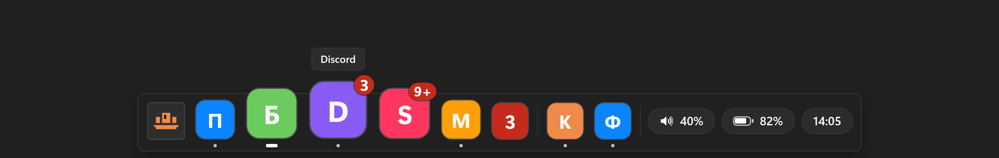
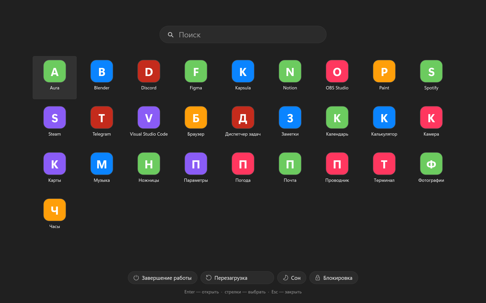

# dock.txt

Док в духе macOS для Windows, часть dev.txt™: закреплённые и запущенные приложения на стеклянной полосе внизу экрана, виджеты прямо в доке, счётчики непрочитанного на значках и меню приложений вместо «Пуска».



Док живёт над панелью задач Windows, а если выбрать в core.txt «Внизу экрана» → «dock.txt» — вместо неё.

## Что умеет

- **Полоса внизу экрана.** По центру рабочей области главного монитора, поверх остальных окон. Фокус не забирает и в Alt+Tab не попадает.
- **Значки.** Сначала закреплённые приложения, за чертой — запущенные, которых среди закреплённых нет. Запущенные — это окна, которые Windows показала бы на панели задач; окна одной программы собираются в один значок.
- **Первый запуск.** Закреплённое берётся с панели задач Windows (ярлыки читаются, ничего не меняется). Ярлыки не на файл программы — «Проводник», приложения из Магазина — пропускаются.
- **Точка под значком** — приложение запущено.
- **Щелчок.** Не запущено — запустить. Запущено — вывести окно вперёд (свёрнутое развернётся). Уже впереди — свернуть, а если окон несколько — перейти к следующему. Средняя кнопка — ещё один экземпляр.
- **Окна над значком.** Курсор задержался на значке запущенной программы — над ним панель с живыми картинками её окон (до пяти): щелчок выводит окно вперёд, крестик закрывает.
- **Перетаскивание.** Закреплённый значок можно перенести на другое место; унесённый высоко над доком и отпущенный — открепляется.
- **Правый щелчок** — меню: окна программы по заголовкам, «Закрепить» или «Открепить», «Закрыть окно», а для самого дока — «Автоскрытие», «Вместо панели задач Windows», «Настройки» и «Выход». «Настройки» открывают страницу дока в core.txt: запущенный core.txt док просит через хаб, а установленный, но закрытый — запускает с ключом `--page app:dock`. Без core.txt вместо этого пункта — «Скачать core.txt».
- **Увеличение под курсором.** Значки рядом с курсором плавно растут, а тот, что под курсором, из-под него не уезжает. Над значком — подпись с названием.
- **Автоскрытие** (по желанию). Док уезжает за нижний край и возвращается, когда курсор ложится на этот край под доком.
- **Игра или видео на весь экран.** Пока такое окно впереди на главном мониторе, дока нет совсем: он уезжает за край и возвращается, когда окно ушло. Игра на другом мониторе доку не мешает — он остаётся на главном, как осталась бы там панель задач Windows. Что считать окном на весь экран, решает одно правило на всю семью dev.txt (`FullScreen` в `Family.cs` из kit.txt): окно ровно по своему монитору, без заголовка и рамки, не развёрнутое, — поэтому развёрнутые Discord и Steam игрой не считаются. Пока core.txt на связи и сообщает `core.family`, решает он (`game`), а на каком мониторе окно впереди, док смотрит сам. Своя проверка у дока — без core.txt и ещё в первые три секунды после смены окна впереди, чтобы не стоять поверх игры, пока core.txt не сказал. Когда игра уходит, док возвращается по слову core.txt — или сразу, если впереди теперь окно на другом мониторе.
- **«Не беспокоить» в core.txt** — новый счётчик непрочитанного появляется на значке без движения; сами счётчики остаются.
- **В покое не тратит ничего.** Раз в секунду смотрит на окна и перерисовывается, только если что-то изменилось. Кадры идут, лишь пока курсор над доком.


## Виджеты

Справа, за чертой, — стеклянные капсулы. Каждую можно выключить или включить в настройках.

Музыка, календарь и погода по умолчанию выключены: то же показывает остров kapsula.txt наверху экрана, и дублировать его незачем. Включите их, если остров спрятан. У тех, кто пользовался доком раньше, они выключаются один раз (в `state.json` остаётся отметка `islandWidgets`); включённые снова так и остаются.

| Виджет | Что показывает | Откуда |
|---|---|---|
| **Музыка** (по умолчанию выключена) | название и исполнитель; под курсором — кнопки «назад», «пауза/пуск», «вперёд» | kapsula.txt через хаб |
| **Календарь** (по умолчанию выключен) | ближайшее событие на сегодня (время или «весь день» и название); в подписи — до пяти событий | kapsula.txt через хаб |
| **Погода** (по умолчанию выключена) | значок (ясно, облачно, дождь, снег, гроза, туман) и температура; в подписи — описание и город | kapsula.txt через хаб |
| **Громкость** | общая громкость и «без звука»; колесо мыши меняет громкость на 2 % за щелчок, щелчок выключает и включает звук | Windows (Core Audio) |
| **Батарея** | заряд и зарядка — только если у компьютера есть батарея | Windows |
| **Часы** | время; в подписи — день недели и дата | Windows |


- Музыки, погоды или календаря нет, пока они выключены или пока kapsula.txt их не прислала; если событий на сегодня не осталось, виджета календаря тоже нет. Без хаба остаются часы, громкость и батарея:

  
- Не помещается на экране — сначала укорачиваются надписи, потом виджеты уходят по одному слева, потом уменьшаются значки.
- Значки виджетов рисуются фигурами в коде: ни картинок, ни шрифтов со значками.
- В покое виджеты ничего не тратят: часы просыпаются раз в минуту, на её границе; об изменении громкости Windows сообщает сама; батарея и смена устройства звука проверяются раз в пять секунд, и док перерисовывается, только если что-то изменилось.

## Счётчики непрочитанного

Красный счётчик в правом верхнем углу значка, растёт вместе с ним; больше девяти — «9+», ноль — счётчика нет. Числа присылает kapsula.txt: `discord` — для Discord (в том числе закреплённого через `Update.exe --processStart Discord.exe`), `steam` — для `steam.exe` и `steamwebhelper.exe`; любой другой ключ — для программы с таким же именем файла.

## Меню приложений

Кнопка слева, со значком дока, открывает меню на весь экран: затемнение, строка поиска и сетка всех программ. Когда dock.txt стоит вместо панели задач, меню открывает и одиночное нажатие кнопки Windows (настройка «Кнопка Windows открывает меню дока»); сочетания вроде Win+E и Win+D работают как обычно. Поверх игры или видео на весь экран одиночное нажатие не открывает ничего — ни меню, ни «Пуск»: само нажатие до игры доходит, и она не теряет фокус.



- **Откуда список.** Ярлыки (`.lnk`) из папок меню «Пуск» — общей и вашей, со всеми вложенными, и приложения из Магазина (Параметры, Калькулятор, Терминал…) из папки приложений Windows. Ярлыки не на файл программы пропускаются. Убираются удаление, справка, «прочти меня» и ссылки на сайты; два ярлыка на одну программу с одними и теми же параметрами считаются одним, а приложение из Магазина с тем же названием, что у ярлыка, второй раз не появляется.
- **Поиск.** Курсор сразу в строке поиска. Подходит начало любого слова и просто часть названия; регистр и «ё/е» не важны. Сначала идут названия, которые начинаются с набранного.
- **Клавиши.** Enter открывает первое найденное (или выбранное стрелками), Esc или щелчок мимо закрывает.
- **Скорость.** Список и значки собираются в фоновом потоке при запуске дока и хранятся в памяти; при открытии, если списку больше минуты, он пересобирается в фоне.
- **Кнопки внизу.** «Сон» и «Блокировка» срабатывают сразу. «Завершение работы» и «Перезагрузка» — со второго щелчка: после первого кнопка спрашивает «Точно выключить?» или «Точно перезагрузить?» и через несколько секунд сама возвращается. В снимках и проверках кнопки ничего не делают.
- Значки появляются короткой волной (общее движение из kit.txt); при «Меньше движения» — сразу.


## Настройки и хаб

Своего окна настроек у дока нет: они на общей странице в core.txt, как у остальных приложений. Док подключается к хабу как `dock` и:

| Что | Тема или команда |
|---|---|
| отдаёт настройки: «Автоскрытие дока», «Увеличение под курсором», «Показывать запущенные», «Размер значков» (36–72); группа «Панель задач»: «Внизу экрана» и «Кнопка Windows открывает меню дока»; группа «Виджеты»: по переключателю на каждый виджет и «Счётчики непрочитанного». Пунктов про игры и автозапуск у дока нет, поэтому ни один не переезжает на общие страницы core.txt (поле `section`) | состояние `dock.settings` |
| принимает изменения | команда `settings.set` |
| отдаёт пункты для общего меню core.txt в трее: `{ "items": [{ "key": "autoHide", "label": "Автоскрытие", "check" }, { "key": "settings", "label": "Настройки" }] }`. Пока внизу экрана компактная панель Windows, дока не видно, и «Автоскрытие» приходит с `"enabled": false`. Своего окна и своего значка в трее у дока нет, поэтому «Открыть» нет | состояние `dock.tray` |
| выполняет пункт из трея: «Автоскрытие» включается или выключается, «Настройки» просят core.txt открыть страницу дока; после этого `dock.tray` приходит заново | команда `tray.run` |
| отдаёт свои горячие клавиши для страницы «Клавиши» в core.txt: `{ "keys": [{ "id": "winKey", "label": "Меню приложений", "keys": "Win", "on" }] }`; `on` — когда dock.txt вместо панели задач и «Кнопка Windows открывает меню дока» включена | состояние `dock.keys` |
| слушает, что сейчас у всей семьи: «Не беспокоить» (`focus`) и игру на весь экран (`game`) | состояние `core.family` |
| отдаёт список приложений: `[{ "name", "path", "running" }]` | состояние `dock.apps` |
| отдаёт, какие виджеты и счётчики сейчас в доке: `{ "shown": ["music", …, "clock"], "badges": [{ "name", "count", "text" }] }` | состояние `dock.widgets` |
| слушает музыку: `{ "playing", "title", "artist", "app" }` или `null` | состояние `kapsula.media` |
| слушает погоду: `{ "temp", "text", "icon", "city" }` или `null`; `icon` — `clear`, `cloudy`, `rain`, `snow`, `storm`, `fog` | состояние `kapsula.weather` |
| слушает календарь: `{ "events": [{ "title", "start", "end", "allDay" }] }` или `null`; время — `ЧЧ:мм` | состояние `kapsula.calendar` |
| слушает непрочитанное: `{ "total", "apps": { "discord", "steam" } }` или `null` | состояние `kapsula.unread` |
| нажимает кнопки музыки | команды `media.prev`, `media.toggle`, `media.next` для `kapsula` |
| следует общему «Меньше движения» | состояние `hub.theme` |
| просит core.txt показать страницу дока | команда `show` для `core` с `{ "page": "app:dock" }` |

Без core.txt док работает сам по себе: «Автоскрытие» есть в его меню, остальное лежит в `%APPDATA%\dev.txt\dock\state.json` вместе с закреплёнными приложениями.

При «Меньше движения» (общем или системном) значки под курсором не растут, а док прячется и появляется сразу, без проезда.

## Сборка

```bash
powershell -ExecutionPolicy Bypass -File build.ps1
```

Собирается встроенным в Windows компилятором C#, как core.txt и Kapsula: ничего ставить и скачивать не нужно. Получается один файл `Dock.exe`.

`src/Tokens.cs`, `src/Ui.cs` и `src/HubLink.cs` скопированы из kit.txt как есть и здесь не правятся.

Значок программы рисуется из [sprite.json](sprite.json) тем же способом, что значки в kit.txt:

```bash
node tools/icon.js
```

## Проверка

```bash
./Dock.exe --selftest
```

| Ключ | Что делает |
|---|---|
| `--selftest` | проверяет сборку значков из окон, закрепление, расчёт увеличения, настройки (и разовое выключение музыки, календаря и погоды), разбор состояний Kapsula, виджеты, счётчики, названия, поиск в меню приложений, пункты для трея и клавиши core.txt и уход из-под игры на весь экран; код выхода 0 — всё в порядке |
| `--demo` | выдуманные значки; окна, диск, реестр и хаб не трогаются |
| `--shot файл.png` | рисует док в файл и выходит (обычно вместе с `--demo`) |
| `--nohub` | вместе с `--demo`: без выдуманных музыки, погоды, календаря и счётчиков |
| `--hover N` | для снимка: будто курсор над значком N; вместо номера — `music`, `calendar`, `weather`, `volume`, `battery`, `clock` или `apps`. Музыка, календарь и погода по умолчанию выключены: с `--demo` виджет, над которым курсор, в снимке включён |
| `--apps` | вместе с `--shot`: рисует меню приложений; `--query текст` — с этим текстом в поиске |
| `--headless` | работает, не показывая окна; `--seconds N` — выходит через N секунд |
| `--testhook` | принимает из хаба проверочные команды `test.act` (`{ "widget": "music", "action": "prev" \| "toggle" \| "next" }`), `test.state` (что док решил про игру на весь экран и «Не беспокоить», на главном ли мониторе окно впереди, спрятана ли панель задач и перехвачена ли кнопка Windows) и `test.quit`; громкость через них не меняется |
| `--menu` | для снимка: с меню этого значка |
| `--probe [файл]` | запускается по-настоящему, проводит по доку выдуманный курсор, записывает, что увидел и что получилось (в том числе громкость, батарею и сколько приложений нашлось в меню «Пуск»), и через пять секунд выходит; с `--headless` — без окна |
| `--state папка` | хранит `state.json` в этой папке, а не в `%APPDATA%\dev.txt\dock` |

Переменная `DOCK_HUB_PORT` — хаб на другом порту, рядом с настоящим core.txt:

```bash
../core/Core.exe --hub 42993
DOCK_HUB_PORT=42993 ./Dock.exe --probe probe.txt --state ./tmp-state
```

Связь с хабом целиком — выдуманные kapsula.txt и core.txt против образцового хаба на свободном порту, док без окна (`--headless`: панель задач и кнопка Windows не трогаются):

```bash
node tools/hubtest.js <папка, где лежат kit и dock>
```

## Что не проверено вживую

Всё перечисленное проверено расчётами (`--selftest`), снимками и прогоном без окна против образцового хаба с выдуманной Kapsula, но не руками:

- **Настоящая мышь над виджетами:** колесо и щелчок по громкости (проверки громкость не меняют — только читают), щелчки по кнопкам музыки, подсказки под настоящим курсором.
- **Меню приложений на экране:** окно на весь экран, фокус в строке поиска, клавиши, закрытие щелчком мимо, волна появления, запуск программы. Снимки делаются тем же кодом, но без окна.
- **Настоящая Kapsula:** док собран по описанию её состояний; с ней самой не запускался.
- **Настоящий core.txt:** общий трей (`dock.tray`, `tray.run`), страница «Клавиши» (`dock.keys`) и `core.family` проверены против образцового хаба с выдуманным core.txt, с самим core.txt — нет. Уход из-под настоящей игры на весь экран вживую не проверялся.
- **Второй монитор:** на компьютере, где шла проверка, монитор один — то, что игра на другом мониторе дока не прячет, проверено только расчётами.
- **Батарея:** на компьютере, где шла проверка, батареи нет — виджет виден только на выдуманных данных.
- **Смена устройства звука** на ходу.

## Чего пока нет

- **Папок в меню приложений:** сетка плоская, по алфавиту.
- **Дока поверх меню приложений:** меню закрывает весь экран, вместе с доком.
- **Размытия за стеклом.** Полоса — тёмная полупрозрачная основа со стеклом и кромкой поверх; то, что за ней, не размывается.
- **Запуска вместе с Windows.** В автозапуск Windows док себя не прописывает: запускать его нужно самому. Своего пункта автозапуска у него нет, поэтому на странице core.txt «Общие» → «Запуск и обновления» дока нет.
- **Светлой темы и своего акцентного цвета** из `hub.theme`.
- **Точных названий у некоторых программ.** Название берётся из описания файла; если оно похоже на вспомогательный процесс (helper, host, launcher) или пустое — из названия продукта, а закреплённое называется по своему ярлыку. Так Steam называется «Steam», а его окно, которое держит `steamwebhelper.exe`, относится к закреплённому Steam. Но это простые правила, и угадывают они не всегда. Свёрнутое окно приложения из Магазина, которое само не говорит, чьё оно, узнаётся только по заголовку, и закрепить его нельзя.
- **Края экрана при видимой панели задач.** Автоскрытый док возвращается, когда курсор ложится на нижний край рабочей области; если под ним панель задач, это узкая полоска над ней.

## Дальше

- значки из трея прямо в доке (сейчас — пункт «Значки в трее»: панель задач Windows ненадолго показывается);
- несколько мониторов: сейчас док только на главном.
