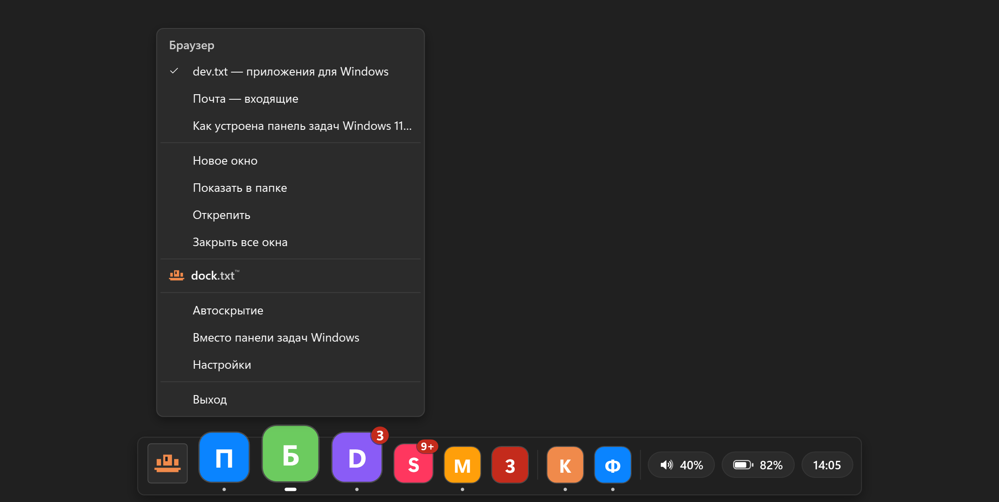
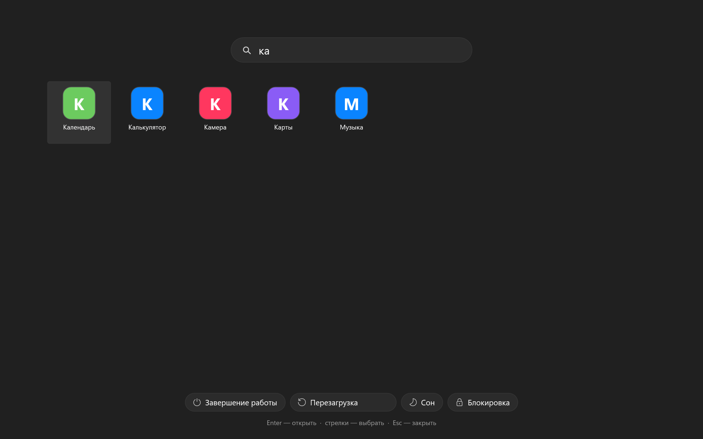

# dock.txt

Док в духе macOS для Windows, часть dev.txt™: закреплённые и запущенные приложения на стеклянной полосе внизу экрана, виджеты прямо в доке, счётчики непрочитанного на значках и меню приложений вместо «Пуска».


Док живёт над панелью задач Windows, а если выбрать в core.txt «Внизу экрана» → «dock.txt» — вместо неё.

## Что умеет

- **Полоса внизу экрана.** По центру рабочей области главного монитора, поверх остальных окон. Фокус не забирает и в Alt+Tab не попадает.
- **Стекло.** За полосой размыто то, что позади: обои и окна. Под полосой стоит отдельное окно-подложка ровно по ней — на нём Windows сама рисует акриловое размытие, а сама полоса поверх — полупрозрачная тёмная тонировка с кромкой, чтобы значки и подписи читались и на белых обоях. Подложка едет вместе с полосой: увеличение под курсором, появление и уход значков, автоскрытие, уход из-под игры. Тень у полосы только снаружи. Размытие — только в Windows 11 и пока включены «Эффекты прозрачности» (Параметры → Персонализация → Цвета; переключение подхватывается на ходу); иначе, как и в снимках, — прежний ровный тёмный фон, тот же, что у острова kapsula.txt.
- **Запуск вместе с Windows** (по умолчанию выключен). Запись `Dock` в `HKCU\Software\Microsoft\Windows\CurrentVersion\Run` с полным путём к `Dock.exe` в кавычках — как у kapsula.txt; по ней core.txt переносит автозапуск, когда программа переезжает. Значение читается из реестра, в `state.json` его нет. С core.txt переключатель — на его странице «Общие» → «Запуск и обновления», без него — пункт «Запускать вместе с Windows» в меню дока.
- **Значки.** Сначала закреплённые приложения, за чертой — запущенные, которых среди закреплённых нет. Запущенные — это окна, которые Windows показала бы на панели задач; окна одной программы собираются в один значок.
- **Первый запуск.** Закреплённое берётся с панели задач Windows (ярлыки читаются, ничего не меняется). Ярлыки не на файл программы — «Проводник», приложения из Магазина — пропускаются.
- **Точка под значком** — приложение запущено. Оранжевая точка — окно программы просит внимания (мигало бы кнопкой на панели задач Windows): сначала значок трижды подпрыгивает, как на Mac, потом остаётся точка, пока окно не выйдет вперёд или не закроется. При «Меньше движения» и «Не беспокоить» в core.txt — без прыжков, сразу точка.
- **Щелчок.** Не запущено — запустить. Запущено — вывести окно вперёд (свёрнутое развернётся). Уже впереди — свернуть, а если окон несколько — перейти к следующему. Средняя кнопка — ещё один экземпляр.
- **Окна над значком.** Курсор задержался на значке запущенной программы — над ним панель с живыми картинками её окон (до пяти): щелчок выводит окно вперёд, крестик закрывает.
- **Перетаскивание.** Закреплённый значок можно перенести на другое место; унесённый высоко над доком и отпущенный — открепляется. Файлы из проводника, брошенные на значок обычной программы, открываются ею: она запускается с их путями (над значком — «Открыть в «Paint»»). Приложения из Магазина и программы, которые запускаются через Update.exe (Discord и ему подобные), файлов не принимают.
- **Правый щелчок** — меню: окна программы по заголовкам, «Закрепить» или «Открепить», «Закрыть окно», а для самого дока — «Автоскрытие», «Запускать вместе с Windows» (только пока core.txt не на связи), «Вместо панели задач Windows», «Настройки» и «Выход». «Настройки» открывают страницу дока в core.txt: запущенный core.txt док просит через хаб, а установленный, но закрытый — запускает с ключом `--page app:dock`. Без core.txt вместо этого пункта — «Скачать core.txt».
- **Увеличение под курсором.** Значки рядом с курсором плавно растут, а тот, что под курсором, из-под него не уезжает. Над значком — подпись с названием.
- **Своё место внизу экрана.** Пока видимый док стоит вместо панели задач, он занимает у Windows полосу внизу главного монитора (AppBar), как сама панель задач: развёрнутые окна и Snap кончаются над доком, а не уходят под него. Полоса — высотой с док в покое (при значках 48 — 77 точек на 100 %); увеличение значков и подписи места не занимают. С автоскрытием и рядом с панелью Windows места док не занимает. Полоса занимается только после того, как панель задач Windows спрятана и ей включено автоскрытие (иначе Windows продолжает держать за ней место). Перед этим, после перезапуска Проводника и когда полосы на краях сдвинулись, док смотрит, есть ли у неё автоскрытие, и если нет — просит его снова и несколько раз проверяет (каждые 0,3 с, до 2,4 с; потом — раз в секунду). Если Windows так его и не включила, док всё равно стоит у самого низа экрана — поверх места спрятанной панели, а не над пустой полосой, — и занимает у Windows только недостающее: высота дока минус то, что держит панель (на 3440×1440 с панелью 72 точки — полоса 5 точек, 1363–1368, рабочая область кончается у верха дока). Включилось автоскрытие — полоса снова во всю высоту дока у самого низа. Смена размера значков, масштаба, разрешения и перезапуск Проводника — полоса встаёт заново. При выходе, при падении и при завершении сеанса место освобождается раньше, чем возвращается панель задач; если док закрыли силой, место за него отдаёт следующий запуск (по файлу `appbar.txt` рядом с настройками).
- **Автоскрытие** (по желанию). Док уезжает за нижний край и возвращается, когда курсор простоял на этом краю 0,35 с: по дороге к прокрутке и кнопкам внизу окна он не выскакивает. Уходит через 0,7 с после того, как курсор ушёл с дока.
- **Win+1…9** — закреплённое в доке приложение с этим номером, как у панели задач Windows и как щелчок по значку: не запущено — запускается, запущено — выходит вперёд, уже впереди — следующее окно или свернуть. Только пока dock.txt стоит вместо панели задач (даже если «Кнопка Windows открывает меню дока» выключена); до Windows такая цифра не доходит, и «Пуск» от отпускания кнопки Windows не открывается. С Shift, Ctrl, Alt, а также Win+0 — как обычно у Windows.
- **Игра или видео на весь экран.** Пока такое окно впереди на главном мониторе, дока нет совсем: он уезжает за край и возвращается, когда окно ушло. От края при автоскрытии он в это время не выезжает, даже если курсор долго стоит внизу (стратегии); Win+1…9 остаются игре. Игра на другом мониторе доку не мешает — он остаётся на главном, как осталась бы там панель задач Windows. Что считать окном на весь экран, решает одно правило на всю семью dev.txt (`FullScreen` в `Family.cs` из kit.txt): окно ровно по своему монитору, без заголовка и рамки, не развёрнутое, — поэтому развёрнутые Discord и Steam игрой не считаются. Пока core.txt на связи и сообщает `core.family`, решает он (`game`), а на каком мониторе окно впереди, док смотрит сам. Своя проверка у дока — без core.txt и ещё в первые три секунды после смены окна впереди, чтобы не стоять поверх игры, пока core.txt не сказал. Когда игра уходит, док возвращается по слову core.txt — или сразу, если впереди теперь окно на другом мониторе.
- **«Не беспокоить» в core.txt** — новый счётчик непрочитанного появляется на значке без движения; сами счётчики остаются.
- **В покое не тратит ничего.** Об окнах сообщает сама Windows (как своей панели задач: создано, закрыто, вышло вперёд, просит внимания); сообщения копятся и разбираются пачкой, а на случай потерянных окна перечитываются раз в 12 с. Раз в секунду док смотрит только на одно окно впереди — не игра ли. Перерисовывается, только если что-то изменилось; кадры идут, лишь пока курсор над доком.



## Виджеты

Справа, за чертой, — стеклянные капсулы. Каждую можно выключить или включить в настройках.

Музыка, календарь и погода по умолчанию выключены: то же показывает остров kapsula.txt наверху экрана, и дублировать его незачем. Включите их, если остров спрятан. У тех, кто пользовался доком раньше, они выключаются один раз (в `state.json` остаётся отметка `islandWidgets`); включённые снова так и остаются.

| Виджет | Что показывает | Откуда |
|---|---|---|
| **Музыка** (по умолчанию выключена) | название и исполнитель; под курсором — кнопки «назад», «пауза/пуск», «вперёд» | kapsula.txt через хаб |
| **Календарь** (по умолчанию выключен) | ближайшее событие на сегодня (время или «весь день» и название); в подписи — до пяти событий | kapsula.txt через хаб |
| **Погода** (по умолчанию выключена) | значок (ясно, облачно, дождь, снег, гроза, туман) и температура; в подписи — описание и город | kapsula.txt через хаб |
| **Громкость** | общая громкость и «без звука»; колесо мыши меняет громкость на 2 % за щелчок, щелчок выключает и включает звук | Windows (Core Audio) |
| **Батарея** | заряд и зарядка — только если у компьютера есть батарея | Windows |
| **Часы** | время; в подписи — день недели и дата | Windows |


- Музыки, погоды или календаря нет, пока они выключены или пока kapsula.txt их не прислала; если событий на сегодня не осталось, виджета календаря тоже нет. Без хаба остаются часы, громкость и батарея:

  
- Не помещается на экране — сначала укорачиваются надписи, потом виджеты уходят по одному слева, потом уменьшаются значки.
- Значки виджетов рисуются фигурами в коде: ни картинок, ни шрифтов со значками.
- В покое виджеты ничего не тратят: часы просыпаются раз в минуту, на её границе; об изменении громкости Windows сообщает сама; батарея и смена устройства звука проверяются раз в пять секунд, и док перерисовывается, только если что-то изменилось.

## Корзина

Самый правый элемент дока, за своей чертой, как на Mac: пиксельный бак в стиле семьи (спрайты `bin` и `bin-full` из kit.txt, `icons/sprites.json`, группа `glyphs`). Растёт под курсором, как значки. Есть, когда включена настройка «Корзина в доке» (`bin`, по умолчанию включена) и metla.txt установлена (`%LOCALAPPDATA%\Programs\dev.txt\Metla\Metla.exe`) или на связи.

- **Что лежит** считает metla.txt и присылает через хаб (`metla.bin`): что-то есть — крышка приподнята, из-под неё торчит бумага; пусто — крышка закрыта. В подписи — «Корзина» и под ней «12 объектов · 1,3 ГБ» или «пусто». Пока metla.txt не на связи — бак пустой, в подписи «metla.txt не запущена».
- **Щелчок** (и правый тоже) — меню: сколько лежит, «Открыть корзину», «Очистить корзину…», за чертой — «Найти, что занимает место…» и «Автозапуск Windows…». Док корзину не очищает: «Очистить корзину…» открывает лист подтверждения в самой metla.txt. Пустая корзина или metla.txt не на связи — пункт неактивен; без metla.txt «Открыть корзину» открывает её проводником, а двух последних пунктов нет.
- **Перетаскивание.** Файлы и папки из проводника, брошенные на бак, уходят в корзину Windows — их можно восстановить. Над баком крышка приподнимается и курсор показывает «Переместить»; на остальные значки файлы не бросаются, как и раньше. Если что-то в корзину не помещается и удалится насовсем, Windows об этом предупредит.

## Счётчики непрочитанного

Красный счётчик в правом верхнем углу значка, растёт вместе с ним; больше девяти — «9+», ноль — счётчика нет. Числа присылает kapsula.txt: `discord` — для Discord (в том числе закреплённого через `Update.exe --processStart Discord.exe`), `steam` — для `steam.exe` и `steamwebhelper.exe`; любой другой ключ — для программы с таким же именем файла.

## Меню приложений

Кнопка слева — плитка той же формы и величины, что значки, из светлого стекла, с сеткой из девяти точек — открывает меню на весь экран: затемнение, строка поиска, закреплённые и сетка всех программ. Под курсором она растёт и подписывается, как значки. Когда dock.txt стоит вместо панели задач, меню открывает и одиночное нажатие кнопки Windows (настройка «Кнопка Windows открывает меню дока»); сочетания вроде Win+E и Win+D работают как обычно. Поверх игры или видео на весь экран одиночное нажатие не открывает ничего — ни меню, ни «Пуск»: само нажатие до игры доходит, и она не теряет фокус.


- **Откуда список.** Ярлыки (`.lnk`) из папок меню «Пуск» — общей и вашей, со всеми вложенными, и приложения из Магазина (Параметры, Калькулятор, Терминал…) из папки приложений Windows. Ярлыки не на файл программы пропускаются. Убираются удаление, справка, «прочти меня» и ссылки на сайты; два ярлыка на одну программу с одними и теми же параметрами считаются одним, а приложение из Магазина с тем же названием, что у ярлыка, второй раз не появляется.
- **Разделы.** Пока поиск пуст, сверху — «Закреплённые»: закреплённые в доке приложения в том же порядке, что в доке (запускаются так же, как щелчком в доке); под ними — «Все приложения». Закреплённых нет — нет и раздела. Сетка не шире семи колонок и прижата к верху.
- **Поиск.** Курсор сразу в строке поиска. При наборе — только найденное, без разделов. Подходит начало любого слова и просто часть названия; регистр и «ё/е» не важны. Сначала идут названия, которые начинаются с набранного.
- **Клавиши.** Enter открывает первое (закреплённое или найденное) или выбранное стрелками, Esc или щелчок мимо закрывает. Стрелки, Home, End и листание ходят по обоим разделам как по одному списку: вниз из короткого ряда — в тот же столбец следующего ряда или на его последний значок.
- **Скорость.** Список и значки собираются в фоновом потоке при запуске дока и хранятся в памяти; при открытии, если списку больше минуты, он пересобирается в фоне.
- **Кнопки внизу.** «Сон» и «Блокировка» срабатывают сразу. «Завершение работы» и «Перезагрузка» — со второго щелчка: после первого кнопка спрашивает «Точно выключить?» или «Точно перезагрузить?» и через несколько секунд сама возвращается. В снимках и проверках кнопки ничего не делают.
- Значки появляются короткой волной (общее движение из kit.txt) сверху вниз, начиная с закреплённых; при «Меньше движения» — сразу.



## Настройки и хаб

Своего окна настроек у дока нет: они на общей странице в core.txt, как у остальных приложений. Док подключается к хабу как `dock` и:

| Что | Тема или команда |
|---|---|
| отдаёт настройки: «Автоскрытие дока», «Увеличение под курсором», «Показывать запущенные», «Корзина в доке» (`bin`), «Размер значков» (36–72), «Запускать вместе с Windows» (`autostart`); группа «Панель задач»: «Внизу экрана» и «Кнопка Windows открывает меню дока»; группа «Виджеты»: по переключателю на каждый виджет и «Счётчики непрочитанного». У `autostart` поле `"section": "startup"` — core.txt показывает его на общей странице «Общие» → «Запуск и обновления»; остальные пункты остаются на странице дока | состояние `dock.settings` |
| принимает изменения | команда `settings.set` |
| отдаёт пункты для общего меню core.txt в трее: `{ "items": [{ "key": "autoHide", "label": "Автоскрытие", "check" }, { "key": "settings", "label": "Настройки" }] }`. Пока внизу экрана компактная панель Windows, дока не видно, и «Автоскрытие» приходит с `"enabled": false`. Своего окна и своего значка в трее у дока нет, поэтому «Открыть» нет | состояние `dock.tray` |
| выполняет пункт из трея: «Автоскрытие» включается или выключается, «Настройки» просят core.txt открыть страницу дока; после этого `dock.tray` приходит заново | команда `tray.run` |
| отдаёт свои горячие клавиши для страницы «Клавиши» в core.txt: `{ "keys": [{ "id": "winKey", "label": "Меню приложений", "keys": "Win", "on" }, { "id": "winDigits", "label": "Закреплённое приложение по номеру", "keys": "Win+1…9", "on" }] }`; у `winKey` `on` — когда dock.txt вместо панели задач и «Кнопка Windows открывает меню дока» включена, у `winDigits` — когда dock.txt вместо панели задач | состояние `dock.keys` |
| слушает, что сейчас у всей семьи: «Не беспокоить» (`focus`) и игру на весь экран (`game`) | состояние `core.family` |
| отдаёт список приложений: `[{ "name", "path", "running" }]` | состояние `dock.apps` |
| отдаёт, какие виджеты и счётчики сейчас в доке: `{ "shown": ["music", …, "clock"], "badges": [{ "name", "count", "text" }] }` | состояние `dock.widgets` |
| слушает музыку: `{ "playing", "title", "artist", "app" }` или `null` | состояние `kapsula.media` |
| слушает погоду: `{ "temp", "text", "icon", "city" }` или `null`; `icon` — `clear`, `cloudy`, `rain`, `snow`, `storm`, `fog` | состояние `kapsula.weather` |
| слушает календарь: `{ "events": [{ "title", "start", "end", "allDay" }] }` или `null`; время — `ЧЧ:мм` | состояние `kapsula.calendar` |
| слушает непрочитанное: `{ "total", "apps": { "discord", "steam" } }` или `null` | состояние `kapsula.unread` |
| нажимает кнопки музыки | команды `media.prev`, `media.toggle`, `media.next` для `kapsula` |
| слушает корзину: `{ "count", "bytes" }`; нет состояния — metla.txt не на связи | состояние `metla.bin` |
| пункты меню корзины — только если у `metla` в `hub.apps` есть такая команда | команды `bin.open` и `show` с `{ "page": "bin" \| "scan" \| "startup" }` для `metla` |
| следует общему «Меньше движения» | состояние `hub.theme` |
| просит core.txt показать страницу дока | команда `show` для `core` с `{ "page": "app:dock" }` |

Без core.txt док работает сам по себе: «Автоскрытие» и «Запускать вместе с Windows» есть в его меню, остальное лежит в `%APPDATA%\dev.txt\dock\state.json` вместе с закреплёнными приложениями (автозапуск — в реестре Windows).

При «Меньше движения» (общем или системном) значки под курсором не растут, а док прячется и появляется сразу, без проезда.

## Сборка

```bash
powershell -ExecutionPolicy Bypass -File build.ps1
```

Собирается встроенным в Windows компилятором C#, как core.txt и Kapsula: ничего ставить и скачивать не нужно. Получается один файл `Dock.exe`.

`src/Tokens.cs`, `src/Ui.cs` и `src/HubLink.cs` скопированы из kit.txt как есть и здесь не правятся.

Значок программы рисуется из [sprite.json](sprite.json) тем же способом, что значки в kit.txt:

```bash
node tools/icon.js
```

## Проверка

```bash
./Dock.exe --selftest
```

| Ключ | Что делает |
|---|---|
| `--selftest` | проверяет своё место внизу экрана (полоса по монитору, масштабу, высоте и автоскрытию), появление от края, Win+1…9, пачки сообщений об окнах, «просит внимания», файлы на значке, сборку значков из окон, закрепление, расчёт увеличения, настройки (и разовое выключение музыки, календаря и погоды), разбор состояний Kapsula, виджеты, счётчики, названия, поиск в меню приложений и стрелки по его разделам, запись автозапуска (реестр при этом не трогается), пункты для трея и клавиши core.txt и уход из-под игры на весь экран; код выхода 0 — всё в порядке |
| `--demo` | выдуманные значки; окна, диск, реестр и хаб не трогаются. С окном (без `--shot`) — со стеклом, как настоящий |
| `--shot файл.png` | рисует док в файл и выходит (обычно вместе с `--demo`) |
| `--nohub` | вместе с `--demo`: без выдуманных музыки, погоды, календаря и счётчиков |
| `--bin full\|empty\|offline` | вместе с `--demo`: что в выдуманной корзине (по умолчанию — 12 объектов, с `--nohub` — metla.txt не на связи) |
| `--asking N` | вместе с `--demo`: окно значка N просит внимания — под ним оранжевая точка | для снимка: будто курсор над значком N; вместо номера — `music`, `calendar`, `weather`, `volume`, `battery`, `clock`, `apps` или `bin`. Музыка, календарь и погода по умолчанию выключены: с `--demo` виджет, над которым курсор, в снимке включён |
| `--apps` | вместе с `--shot`: рисует меню приложений; `--query текст` — с этим текстом в поиске |
| `--headless` | работает, не показывая окна; `--seconds N` — выходит через N секунд |
| `--testhook` | принимает из хаба проверочные команды `test.act` (`{ "widget": "music", "action": "prev" \| "toggle" \| "next" }` или `{ "widget": "bin", "action": "open" \| "clean" \| "scan" \| "startup" }` — пункт меню корзины, в ответе `sent` — что ушло), `test.state` (что док решил про игру на весь экран и «Не беспокоить», на главном ли мониторе окно впереди, спрятана ли панель задач и перехвачена ли кнопка Windows и Win+1…9; в `bin` — есть ли бак, какой спрайт, подпись и меню; в `appBar` — занял бы док место внизу экрана, занял ли и какое; в `attention` — кто просит внимания), `test.shell` (`{ "event": "flash" | "activated" | "destroyed" | "created", "app"?: название }` — будто Windows прислала сообщение об окне этой программы) и `test.quit`; громкость через них не меняется |
| `--menu` | для снимка: с меню этого значка |
| `--probe [файл]` | запускается по-настоящему, проводит по доку выдуманный курсор, записывает, что увидел и что получилось (в том числе громкость, батарею и сколько приложений нашлось в меню «Пуск»), и через пять секунд выходит; с `--headless` — без окна |
| `--state папка` | хранит `state.json` в этой папке, а не в `%APPDATA%\dev.txt\dock` |

Переменная `DOCK_HUB_PORT` — хаб на другом порту, рядом с настоящим core.txt:

```bash
../core/Core.exe --hub 42993
DOCK_HUB_PORT=42993 ./Dock.exe --probe probe.txt --state ./tmp-state
```

Связь с хабом целиком — выдуманные kapsula.txt и core.txt против образцового хаба на свободном порту, док без окна (`--headless`: панель задач и кнопка Windows не трогаются):

```bash
node tools/hubtest.js <папка, где лежат kit и dock>
```

## Что не проверено вживую

Всё перечисленное проверено расчётами (`--selftest`), снимками и прогоном без окна против образцового хаба с выдуманной Kapsula, но не руками:

- **Настоящая мышь над виджетами:** колесо и щелчок по громкости (проверки громкость не меняют — только читают), щелчки по кнопкам музыки, подсказки под настоящим курсором.
- **Меню приложений на экране:** окно на весь экран, фокус в строке поиска, клавиши, закрытие щелчком мимо, волна появления, запуск программы. Снимки делаются тем же кодом, но без окна.
- **Настоящая Kapsula:** док собран по описанию её состояний; с ней самой не запускался.
- **Настоящий core.txt:** общий трей (`dock.tray`, `tray.run`), страница «Клавиши» (`dock.keys`) и `core.family` проверены против образцового хаба с выдуманным core.txt, с самим core.txt — нет. Уход из-под настоящей игры на весь экран вживую не проверялся.
- **Второй монитор:** на компьютере, где шла проверка, монитор один — то, что игра на другом мониторе дока не прячет, проверено только расчётами.
- **Батарея:** на компьютере, где шла проверка, батареи нет — виджет виден только на выдуманных данных.
- **Смена устройства звука** на ходу.
- **Стекло.** Проверено на Windows 11 (сборка 26200) с выдуманным доком (`--demo` с окном) поверх яркого полосатого окна: за полосой размытые полосы, подписи читаются, углы подложки не выступают из-под скруглённой полосы. Не проверено вживую: как подложка идёт за полосой при увеличении под курсором и при проезде за край (возможна задержка на кадр), разные обои, выключенные «Эффекты прозрачности» и их переключение на ходу, Windows 10 (там размытия нет по замыслу — только по коду), другой масштаб экрана.
- **Запуск вместе с Windows:** запись в реестр настоящим доком и вход в Windows с ней не проверялись — проверены только сборка записи и пункт в `dock.settings` (`--selftest`, hubtest без записи в реестр).

- **Корзина:** проверена расчётами (`--selftest`), снимками и прогоном без окна против образцового хаба с выдуманной metla.txt (меню отправляет `bin.open` и `show` с `bin`, `scan`, `startup`). Не проверены вживую: настоящая metla.txt, перетаскивание файлов из проводника на бак (сам вызов Windows `SHFileOperation` в корзину на настоящих файлах не запускался), открытие корзины проводником без metla.txt, меню бака с клавиатуры.

- **Док по привычкам Windows** (своё место, автоскрытие, игры, Win+1…9, «просит внимания», файлы на значке, сообщения об окнах): проверены расчётами (`--selftest`), снимком оранжевой точки (`--demo --asking 2`) и прогоном без окна против образцового хаба (`test.state` показывает, какое место док занял бы; поддельное сообщение `test.shell` ставит и снимает «просит внимания»). Без окна док ничего не регистрирует, кнопку Windows не перехватывает и сообщений Windows об окнах не получает — поэтому вживую не проверено ничего из этого: настоящая регистрация полосы и то, что развёрнутые окна встают над доком; её освобождение при выходе, при падении, после закрытия силой (следующим запуском) и при возврате панели Windows; перезапуск Проводника, смена масштаба и разрешения, другие полосы на нижнем краю; повторная просьба автоскрытия у спрятанной панели задач и то, что Windows отвечает на неё (на машине, где Windows 11 не приняла его, — с компактной панелью `TabletPostureTaskbar` = 1, панель 72 точки, — почему, не выяснено), и узкая полоса «недостающего» с доком поверх места панели; появление от края через 0,35 с под настоящей мышью и в настоящей игре; Win+1…9 настоящим перехватчиком (нет ли двойного действия и открытия «Пуска», выходит ли окно вперёд — Windows может не дать фоновой программе вывести окно); настоящие сообщения Windows об окнах и мигание кнопкой (`FlashWindowEx`), прыжки на экране; перетаскивание файлов из проводника на значок и запуск программы с ними.

## Чего пока нет

- **Папок в меню приложений:** под закреплёнными — плоская сетка по алфавиту.
- **Дока поверх меню приложений:** меню закрывает весь экран, вместе с доком.
- **Размытия в Windows 10** — там полоса ровная тёмная.
- **Светлой темы и своего акцентного цвета** из `hub.theme`.
- **Точных названий у некоторых программ.** Название берётся из описания файла; если оно похоже на вспомогательный процесс (helper, host, launcher) или пустое — из названия продукта, а закреплённое называется по своему ярлыку. Так Steam называется «Steam», а его окно, которое держит `steamwebhelper.exe`, относится к закреплённому Steam. Но это простые правила, и угадывают они не всегда. Свёрнутое окно приложения из Магазина, которое само не говорит, чьё оно, узнаётся только по заголовку, и закрепить его нельзя.
- **Края экрана при видимой панели задач.** Автоскрытый док возвращается, когда курсор ложится на нижний край рабочей области; если под ним панель задач, это узкая полоска над ней.

## Дальше

- значки из трея прямо в доке (сейчас — пункт «Значки в трее»: панель задач Windows ненадолго показывается);
- несколько мониторов: сейчас док только на главном.
